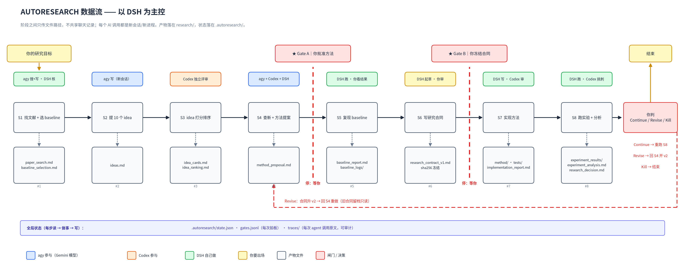

# AUTORESEARCH 计划（一张图 + 几行字）



> 图能改：`python3 docs/autoresearch-dataflow.py` 重新生成（PNG + SVG 同名输出）。
> 细节（文件字段、状态机、MCP 配置、决策记录）在 [AUTORESEARCH_DETAILS.md](AUTORESEARCH_DETAILS.md)。

## 一句话

你说一个研究方向 → DSH 按 8 步往下走 → 每步产物写成文件 → 下一步读文件 → 中间停 3 次等你拍板。

## 三个 AI 各管一段

- **DSH**：调度 + 执行。决定下一步、管文件、跑检索脚本、跑实验。
- **agy（Gemini 模型）**：搜 + 写。用它自己内置的 web 工具检索文献、提 idea、起草方法提案。仓库里任何 `gemini` CLI 调用都会改成 `agy`。
- **Codex**：挑刺。独立评审 idea、审代码、挑结果毛病。它读不到 DSH 的对话，所以是真独立。

三者都通过 MCP 调（`mcp__codex__*`、`mcp__model-worker__*`、`mcp__model-scout__*`、`mcp__antigravity__*`），你不需要手动切换窗口。

## 你只出场 3 次

| 停在哪 | 你要做的 | 怎么回复 |
|---|---|---|
| S4 之后（Gate A） | 方法提案行不行 | 说"过"或写修改意见 |
| S6 之后（Gate B） | 研究合同冻不冻 | 说"冻"或改条款 |
| S8 之后 | 结果如何 | 说"继续 / 改 / 杀" |

前两次是**闸门**：不放行就一直停着，隔三天回来也能接上。第三次不是闸门，是这一轮跑完了让你定下一轮。

平时想插话就往 `research/human_notes.md` 里写，每步开始前都会读。

## 它不会骗自己（3 条硬规则）

1. **合同冻了不能改**，改了系统停，只能开 v2。
2. **每个结论必须对着一个真实实验文件**，对不上标"未证实"。
3. **实验结果只能新增，不能覆盖**。

## 怎么用

```bash
/autoresearch "我想做 XXX 方向"     # 从 S1 开始
/autoresearch --resume              # 停在闸门后，接着跑
/autoresearch --stage S4            # 只重跑某一步
```

## 我要动什么

1. 改写 6 个旧 skill（文献/idea/评审/方法/实验 → 对应到 8 步）
2. 新写 3 个 skill：`baseline-repro`、`research-contract`、`autoresearch`
3. 新写 3 个 Python 工具：状态机、合同校验、证据链
4. 删 4 个旧编排器（功能吸收进 `/autoresearch`，约 30 个原子 skill 保留）

## 进度（2026-11-06）

| 批次 | 你能看到什么 | 时间 | 状态 |
|---|---|---|---|
| B0 | 一个可回退的 git 提交点 | 10 分钟 | ✅ 完成（tag `pre-autoresearch`，工作树干净） |
| B1 | `tools/autoresearch_state.py` 状态机 + 7 个测试 | 2-3 小时 | ✅ 完成（987 passed / 4 skipped） |
| B2 | DSH 里能真调 agy 和 Codex | 1.5 小时 | 🟡 配置已写入，**等一次 DSH 重启**才算生效 |
| B3 | 8 个步骤各自能单独跑 | 6-8 小时 | ⬜ 未开始 |
| B4 | 一条命令跑到闸门，能停能续 | 2 小时 | ⬜ 未开始 |
| B5 | 文档/测试/装机更新，CI 绿 | 2 小时 | ⬜ 未开始 |

**已真跑通 S1→S2→S3**（不是模拟）：agy 搜 13 篇全核验 → agy 提 10 个 idea × 7 字段 → codex 独立打分排序。细节见 `AUTORESEARCH_DETAILS.md` 的 K 节。

## 下一步

- **"继续 B3"** → 改 6 个旧 skill + 新写 3 个（`/autoresearch`、`baseline-repro`、`research-contract`）
- **"先重启 DSH"** → 让 B2 的 4 个 MCP 生效，我再实测 `mcp__model-scout__worker`