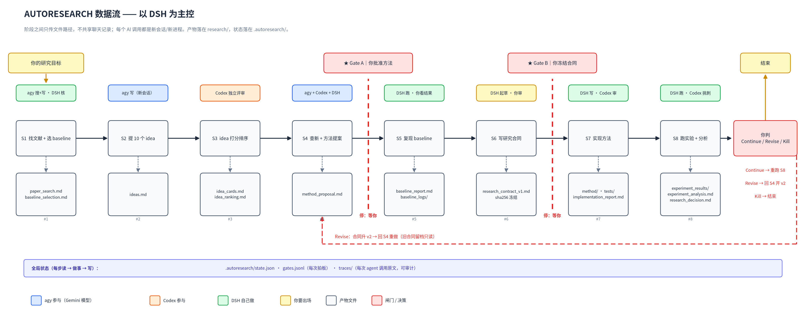

# autoresearch

An 8-stage research pipeline that takes a one-line direction and walks it to
analyzed experiments: literature → ideas → ranking → method proposal → baseline
reproduction → research contract → implementation → experiments.

Three models split the work. **DSH** (or Claude Code / Codex CLI) orchestrates
and runs commands. **agy** (Antigravity CLI, Gemini models) searches and writes.
**Codex** reviews and implements. They never share a conversation — every handoff
is a Markdown file in `research/`, and the only thing that decides "what happens
next" is the state machine in [`tools/autoresearch_state.py`](tools/autoresearch_state.py).

You appear twice: after the method proposal (Gate A) and after the research
contract (Gate B).



> Derived from [ARIS](https://github.com/wanshuiyin/Auto-claude-code-research-in-sleep) (MIT).
> The plan and its rationale live in [AUTORESEARCH_PLAN.md](AUTORESEARCH_PLAN.md);
> field-level detail in [AUTORESEARCH_DETAILS.md](AUTORESEARCH_DETAILS.md).

<a id="contents"></a>
## Contents

[1. The eight stages](#1-the-eight-stages) ·
[2. How a stage runs](#2-how-a-stage-runs) ·
[3. Quick start](#3-quick-start) ·
[4. MCP servers](#4-mcp-servers) ·
[5. Repository layout](#5-repository-layout) ·
[6. Skills and mirrors](#6-skills-and-mirrors) ·
[7. What is enforced, and what is not](#7-what-is-enforced-and-what-is-not) ·
[8. Development](#8-development) ·
[9. Attribution and license](#9-attribution-and-license)

<a id="the-eight-stages"></a>
## 1. The eight stages

Each stage writes fixed files into `research/`. A stage is done when those files
exist — the state machine refuses the transition otherwise.

| Stage | Produces | Written by | Gate after |
|---|---|---|---|
| S1 literature + baseline pick | `paper_search.md`, `baseline_selection.md` | agy scout | — |
| S2 ten idea cards | `ideas.md`, `idea_cards.md` | agy worker | — |
| S3 independent ranking | `idea_ranking.md` | Codex | — |
| S4 novelty check + method proposal | `method_proposal.md` | agy scout, Codex second opinion | **A** |
| S5 baseline reproduction | `baseline_report.md` | DSH (runs the commands itself) | — |
| S6 research contract | `research_contract_v1.md` (sha256 frozen) | DSH | **B** |
| S7 implementation | `implementation_report.md`, `method/`, `tests/` | Codex | — |
| S8 experiments + analysis | `experiment_analysis.md`, `research_decision.md` | DSH | — |

A run finishes at S8 with a Continue / Revise / Kill decision. A `revise` decision
can go back to S4 with a new contract version.

The artifacts land under `research/` in whatever project you start the run in;
nothing is written into this repository itself.

<a id="how-a-stage-runs"></a>
## 2. How a stage runs

```bash
python3 tools/autoresearch_state.py next     # what is next, who does it, which files
python3 tools/autoresearch_state.py start    # claim the stage
# … dispatch to agy / Codex / run the commands yourself …
python3 tools/autoresearch_state.py done     # refused if the stage's files are missing
```

`next` prints the stage, the actor, the exact input paths, the exact output paths,
and what is still missing. The orchestrator does not decide anything from memory.

**Dispatch is by path, not by content.** Every agent call carries a five-field
brief — `READ ONLY`, `WRITE`, `MUST CONTAIN`, `DO NOT`, `REPORT` — with paths and
acceptance criteria, never pasted upstream text. A long brief defeats the context
isolation the pipeline exists for.

**The agent's chat reply is not evidence.** After every agent call the orchestrator
checks the declared files on disk.

**Gates are human.** `gate approve --note "…"` advances; `gate reject --note "…"`
sends the work back (on Gate B, back to S4). Every decision appends a line to
`.autoresearch/gates.jsonl` with the frozen contract hash.

**Failure protocol.** Same brief plus `PREVIOUS ATTEMPT FAILED: …`, retried once.
A second failure records `fail --reason` and stops; the acceptance bar is never
lowered to get past a stage.

<a id="quick-start"></a>
## 3. Quick start

<a id="101-prerequisites"></a>
### 3.1 Prerequisites

- Python 3.10+ (the pipeline tools are stdlib-only)
- A logged-in `codex` CLI — the reviewer and the implementer
- `agy` (Antigravity CLI) 1.5+, with the three agent profiles installed
- An agent CLI to orchestrate: DSH, Claude Code, or Codex CLI

The three agy profiles are plain Markdown files in this repo:

```bash
mkdir -p ~/.gemini/config/agents
cp mcp-servers/model-worker/aris-model-worker.md \
   mcp-servers/model-worker/aris-scout.md \
   mcp-servers/antigravity-exec/aris-antigravity-review.md \
   ~/.gemini/config/agents/
agy agent    # must list aris-model-worker, aris-scout, aris-antigravity-review
```

`agy` accepts only `commandExecutionPolicy: off` or `auto` in a profile; `on`
silently drops the profile from `agy agent`.

<a id="102-install-skills"></a>
### 3.2 Install skills

Skills are symlinked into a project so the agent CLI discovers them:

```bash
bash tools/install_aris.sh /path/to/your/project                  # interactive picker
bash tools/install_aris.sh /path/to/your/project --groups core    # or by group
bash tools/install_aris.sh --list-groups                          # what the groups are
```

For Codex CLI, install the mirror instead: `bash tools/install_aris_codex.sh`.

<a id="103-update-skills"></a>
### 3.3 Update skills

Re-run the installer with `--reconcile` after pulling. The manifest at
`.aris/installed-skills.txt` tracks what was installed, so uninstall removes only
its own links.

<a id="104-usage"></a>
### 3.4 Usage

```bash
/autoresearch "your research direction"    # start at S1
/autoresearch --resume                     # continue a run that stopped at a gate
/autoresearch --status                     # where am I
/autoresearch --stage S4                   # re-run one stage
```

State lives in `.autoresearch/state.json`, gate decisions in
`.autoresearch/gates.jsonl`. Notes you want read before every stage go in
`research/human_notes.md`.

<a id="105--auto-allow-for-overnight-runs-optional"></a>
### 3.5 Auto-allow for overnight runs (optional)

Gates A and B are deliberately manual: an unattended run stops there, and that is
the point. For the surrounding tool permissions, allow the specific commands your
experiments need rather than opening every tool.

<a id="mcp-servers"></a>
## 4. MCP servers

Four entries are registered with the orchestrator; the servers live in
[`mcp-servers/`](mcp-servers/). Each is a stdio MCP server that shells out to a CLI
and returns its output.

| Tool | Server | Runs | Role |
|---|---|---|---|
| `mcp__codex__codex` | `codex-exec` | `codex exec` | S3 ranking, S4 second opinion, S7 implementation |
| `mcp__model-worker__worker` | `model-worker` (`AGY_AGENT=aris-model-worker`) | `agy -p` | S2 idea cards |
| `mcp__model-scout__worker` | `model-worker` (`AGY_AGENT=aris-scout`) | `agy -p --agent aris-scout` | S1 literature, S4 novelty |
| `mcp__antigravity__antigravity` | `antigravity-exec` | `agy -p --agent aris-antigravity-review` | read-only review and follow-up |

Two environment quirks on this machine, both handled in the dispatch table:
`codex exec` needs `IAIEMAS_API_KEY` in its environment and
`--sandbox danger-full-access` (bubblewrap cannot start here); headless `agy`
needs `--dangerously-skip-permissions` or every tool call is auto-denied.

Registration is one YAML block per server; see [SETUP_GUIDE.md](SETUP_GUIDE.md)
and [AUTORESEARCH_DETAILS.md](AUTORESEARCH_DETAILS.md) §F for the exact config.

<a id="repository-layout"></a>
## 5. Repository layout

```
skills/                 49 skills, Markdown specs the agent CLI loads
  skills-codex/         Codex-native mirror (spawn_agent instead of Codex MCP)
  skills-codex-claude-review/   frozen overlay
  skills-codex-gemini-review/   frozen overlay (5 skills)
mcp-servers/            9 stdio bridges (codex, agy, review, notifications)
tools/                  25 helpers; autoresearch_state.py is the state machine
templates/              project templates
agents/                 leaf-agent definitions
tests/                  961 passing tests, no network required
docs/                   dataflow diagram, skills catalog, session recovery
```

<a id="skills-and-mirrors"></a>
## 6. Skills and mirrors

[`docs/SKILLS_CATALOG.md`](docs/SKILLS_CATALOG.md) lists all 49 skills with role
and dependencies. The pipeline entry point is [`/autoresearch`](skills/autoresearch/SKILL.md);
six of the skills it dispatches to carry an `## Autoresearch stage contract`
section that pins their inputs, outputs and verification.

Skills are grouped in [`tools/skill-groups.tsv`](tools/skill-groups.tsv).
`python3 tools/check_skills_inventory.py` verifies that the manifest, the catalog
and the Codex mirror agree — the test suite runs it.

<a id="what-is-enforced-and-what-is-not"></a>
## 7. What is enforced, and what is not

Enforced by code:

- **Stage contract** — `done` fails if a stage's declared files are missing; a
  failed stage cannot silently merge into the next one.
- **One stage at a time** — `start` refuses while a gate is open or the run has
  finished.
- **Gate trail** — approve / reject / reopen are append-only lines in
  `.autoresearch/gates.jsonl`, each carrying the contract hash and a note.
- **Contract immutability at S6** — the file's sha256 is recorded; a different
  hash is refused unless you explicitly bump to `--contract-version 2`.

Required by the skill and checked by a human, not yet by a script:

- Re-checking the frozen contract hash at the start of S7 and S8.
- Mapping every claim in the contract to a real file under `experiment_results/`.
  There is no `evidence_chain.py`: "no number without a log path" is a rule in
  [`skills/autoresearch/SKILL.md`](skills/autoresearch/SKILL.md), not a validator.
- Per-call traces under `.autoresearch/traces/` — the directory is created and the
  orchestrator is supposed to write brief/reply/diff there, but nothing writes it
  automatically.

<a id="development"></a>
## 8. Development

```bash
python3 tools/check_skills_inventory.py    # manifest ⇄ catalog ⇄ mirror
pytest tests/ -q                           # 961 passed, 4 skipped
python3 docs/autoresearch-dataflow.py      # regenerate the dataflow PNG + SVG
```

Tests run offline; the ones that would call a model are skipped by default.

<a id="attribution-and-license"></a>
## 9. Attribution and license

MIT. Original work: [ARIS — Auto-claude-code-research-in-sleep](https://github.com/wanshuiyin/Auto-claude-code-research-in-sleep),
Copyright (c) 2026 wanshuiyin. This repository keeps that license and adds the
autoresearch pipeline: `tools/autoresearch_state.py`, three skills
(`/autoresearch`, `/baseline-repro`, `/research-contract`), the stage contracts,
and agy routing in place of the former `gemini` CLI calls.
