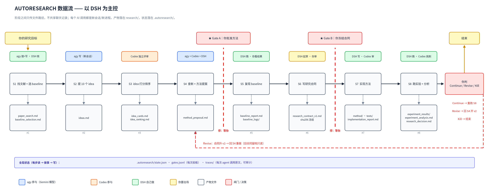

# autoresearch

一条 8 步的科研流水线：给一句话方向，一路走到实验分析——
文献 → idea → 排序 → 方法提案 → 复现 baseline → 研究合同 → 实现 → 跑实验。

三个模型分工。**DSH**（也可以是 Claude Code / Codex CLI）负责调度和跑命令；
**agy**（Antigravity CLI，跑 Gemini 模型）负责检索和写作；**Codex** 负责评审和实现。
它们之间不看彼此的对话——所有交接都是 `research/` 里的 Markdown 文件，
而"下一步做什么"只由 [`tools/autoresearch_state.py`](tools/autoresearch_state.py) 这个状态机决定。

你只出场两次：方法提案之后（Gate A）、研究合同之后（Gate B）。



> 改造自 [ARIS](https://github.com/wanshuiyin/Auto-claude-code-research-in-sleep)（MIT）。
> 计划与取舍见 [AUTORESEARCH_PLAN.md](AUTORESEARCH_PLAN.md)，
> 字段级细节见 [AUTORESEARCH_DETAILS.md](AUTORESEARCH_DETAILS.md)。

<a id="contents"></a>
## 目录

[1. 八步流水线](#1-八步流水线) ·
[2. 一步是怎么跑的](#2-一步是怎么跑的) ·
[3. 快速开始](#3-快速开始) ·
[4. MCP 服务](#4-mcp-服务) ·
[5. 仓库结构](#5-仓库结构) ·
[6. Skills 与镜像](#6-skills-与镜像) ·
[7. 哪些是代码强制的，哪些还不是](#7-哪些是代码强制的哪些还不是) ·
[8. 开发](#8-开发) ·
[9. 出处与许可](#9-出处与许可)

<a id="the-eight-stages"></a>
## 1. 八步流水线

每一步把固定文件写进 `research/`。文件在，这一步才算完；状态机会拒绝跳步。

| 步骤 | 产出 | 谁写 | 之后有闸门 |
|---|---|---|---|
| S1 文献 + 选 baseline | `paper_search.md`、`baseline_selection.md` | agy scout | — |
| S2 十张 idea 卡 | `ideas.md`、`idea_cards.md` | agy worker | — |
| S3 独立打分排序 | `idea_ranking.md` | Codex | — |
| S4 查新 + 方法提案 | `method_proposal.md` | agy scout，Codex 出第二意见 | **A** |
| S5 复现 baseline | `baseline_report.md` | DSH 自己跑命令 | — |
| S6 研究合同 | `research_contract_v1.md`（sha256 冻结） | DSH | **B** |
| S7 实现方法 | `implementation_report.md`、`method/`、`tests/` | Codex | — |
| S8 跑实验 + 分析 | `experiment_analysis.md`、`research_decision.md` | DSH | — |

跑完 S8 给出 Continue / Revise / Kill 结论；`revise` 可以带着新版本合同回到 S4。

产物落在你启动流水线的那个项目的 `research/` 下，不会写进本仓库。

<a id="how-a-stage-runs"></a>
## 2. 一步是怎么跑的

```bash
python3 tools/autoresearch_state.py next     # 下一步是什么、谁做、读写哪些文件
python3 tools/autoresearch_state.py start    # 领取这一步
# … 派给 agy / Codex，或者自己跑命令 …
python3 tools/autoresearch_state.py done     # 文件缺失就拒绝
```

`next` 会打印步骤号、执行者、精确输入路径、精确输出路径、还缺什么。
调度者不凭记忆决定下一步。

**派活只给路径，不给内容。** 每次调用带五段 brief——`READ ONLY`、`WRITE`、
`MUST CONTAIN`、`DO NOT`、`REPORT`——里面是路径和验收条件，不粘贴上游正文。
brief 一长，上下文隔离就白做了。

**agent 的聊天回复不算证据。** 每次调用之后，调度者自己去磁盘上核对声明的文件。

**闸门是人。** `gate approve --note "…"` 放行；`gate reject --note "…"` 打回
（Gate B 打回到 S4）。每次决定往 `.autoresearch/gates.jsonl` 追加一行，带合同 hash。

**失败处理。** 同一份 brief 加一行 `PREVIOUS ATTEMPT FAILED: …`，重试一次。
第二次失败就 `fail --reason` 停下；不为了过这一步降低验收标准。

<a id="quick-start"></a>
## 3. 快速开始

<a id="101-prerequisites"></a>
### 3.1 前置条件

- Python 3.10+（流水线工具只用标准库）
- 已登录的 `codex` CLI——评审者和实现者
- `agy`（Antigravity CLI）1.5+，且装好三个 agent profile
- 一个负责调度的 agent CLI：DSH、Claude Code 或 Codex CLI

三个 agy profile 就是本仓库里的 Markdown 文件：

```bash
mkdir -p ~/.gemini/config/agents
cp mcp-servers/model-worker/aris-model-worker.md \
   mcp-servers/model-worker/aris-scout.md \
   mcp-servers/antigravity-exec/aris-antigravity-review.md \
   ~/.gemini/config/agents/
agy agent    # 必须能列出 aris-model-worker、aris-scout、aris-antigravity-review
```

profile 里的 `commandExecutionPolicy` 只接受 `off` 或 `auto`；写 `on` 会让这个
profile 从 `agy agent` 里静默消失。

<a id="102-install-skills"></a>
### 3.2 安装 skills

skills 通过软链接装进项目，agent CLI 才扫得到：

```bash
bash tools/install_aris.sh /path/to/your/project                  # 交互式勾选
bash tools/install_aris.sh /path/to/your/project --groups core    # 或按组装
bash tools/install_aris.sh --list-groups                          # 有哪些组
```

用 Codex CLI 的话改装镜像：`bash tools/install_aris_codex.sh`。

<a id="103-update-skills"></a>
### 3.3 更新 skills

拉完代码后重跑安装脚本并加 `--reconcile`。清单记在
`.aris/installed-skills.txt`，所以卸载只删自己装的链接。

<a id="104-usage"></a>
### 3.4 用法

```bash
/autoresearch "你的研究方向"     # 从 S1 开始
/autoresearch --resume          # 停在闸门后继续
/autoresearch --status          # 我现在在哪一步
/autoresearch --stage S4        # 只重跑某一步
```

状态在 `.autoresearch/state.json`，闸门决定在 `.autoresearch/gates.jsonl`。
想让每一步开始前都读到的备注写进 `research/human_notes.md`。

<a id="105--auto-allow-for-overnight-runs-optional"></a>
### 3.5 无人值守（可选）

Gate A / Gate B 是故意留给人签的：没人签，流水线就停在那儿，这是设计意图。
至于周边工具权限，建议只放开实验真正需要的那几条命令，而不是全部打开。

<a id="mcp-servers"></a>
## 4. MCP 服务

调度侧注册了 4 个条目，服务端都在 [`mcp-servers/`](mcp-servers/)。每个都是
stdio MCP 服务，壳一层 CLI 再把输出返回。

| 工具 | 服务 | 实际执行 | 用途 |
|---|---|---|---|
| `mcp__codex__codex` | `codex-exec` | `codex exec` | S3 排序、S4 第二意见、S7 实现 |
| `mcp__model-worker__worker` | `model-worker`（`AGY_AGENT=aris-model-worker`） | `agy -p` | S2 idea 卡 |
| `mcp__model-scout__worker` | `model-worker`（`AGY_AGENT=aris-scout`） | `agy -p --agent aris-scout` | S1 文献、S4 查新 |
| `mcp__antigravity__antigravity` | `antigravity-exec` | `agy -p --agent aris-antigravity-review` | 只读审阅与追问 |

这台机器上有两个环境坑，已写进调度表：`codex exec` 需要环境里有
`IAIEMAS_API_KEY`，并且必须 `--sandbox danger-full-access`（bubblewrap 起不来）；
headless 的 `agy` 需要 `--dangerously-skip-permissions`，否则所有工具调用被自动拒绝。

每个服务一段 YAML 配置；确切写法见 [SETUP_GUIDE_CN.md](SETUP_GUIDE_CN.md)
和 [AUTORESEARCH_DETAILS.md](AUTORESEARCH_DETAILS.md) §F。

<a id="repository-layout"></a>
## 5. 仓库结构

```
skills/                 49 个 skill，agent CLI 加载的 Markdown 规格
  skills-codex/         Codex 原生镜像（spawn_agent 替代 Codex MCP）
  skills-codex-claude-review/   冻结的 review overlay
  skills-codex-gemini-review/   冻结的 review overlay（5 个 skill）
mcp-servers/            9 个 stdio 桥（codex、agy、评审、通知）
tools/                  25 个辅助脚本；autoresearch_state.py 是状态机
templates/              项目模板
agents/                 leaf agent 定义
tests/                  961 个测试，全部离线
docs/                   数据流图、skills 目录、会话恢复指南
```

<a id="skills-and-mirrors"></a>
## 6. Skills 与镜像

全部 49 个 skill 的用途与依赖见 [`docs/SKILLS_CATALOG.md`](docs/SKILLS_CATALOG.md)。
流水线入口是 [`/autoresearch`](skills/autoresearch/SKILL.md)；它派发到的 6 个
skill 各带一段 `## Autoresearch stage contract`，把输入、输出、验收固定下来。

skill 分组在 [`tools/skill-groups.tsv`](tools/skill-groups.tsv)。
`python3 tools/check_skills_inventory.py` 校验清单、目录文档、Codex 镜像三者一致，
测试套件会跑它。

<a id="what-is-enforced-and-what-is-not"></a>
## 7. 哪些是代码强制的，哪些还不是

代码强制：

- **步骤契约**——`done` 时该步产出文件缺失就直接失败；失败的步骤不会悄悄并进下一步。
- **一次只跑一步**——闸门开着或整轮已结束时，`start` 拒绝执行。
- **闸门留痕**——approve / reject / reopen 追加进 `.autoresearch/gates.jsonl`，
  每条带合同 hash 和备注。
- **S6 合同冻结**——记录文件 sha256；换了内容会被拒绝，除非显式 `--contract-version 2`。

靠 skill 规则和人盯，暂时没有脚本校验：

- 在 S7、S8 开始时重新核对已冻结的合同 hash。
- 合同里每条 claim 映射到 `experiment_results/` 下的真实文件。仓库里**没有**
  `evidence_chain.py`：`skills/autoresearch/SKILL.md` 里"没有日志路径的数字不许写"
  是一条规则，不是校验器。
- 每次调用在 `.autoresearch/traces/` 下的原文留档——目录会建，调度方本该把
  brief/回复/diff 写进去，但目前没有任何东西自动写它。

<a id="development"></a>
## 8. 开发

```bash
python3 tools/check_skills_inventory.py    # 清单 ⇄ 目录文档 ⇄ 镜像
pytest tests/ -q                           # 961 passed, 4 skipped
python3 docs/autoresearch-dataflow.py      # 重新生成数据流图 PNG + SVG
```

测试全部离线；会真正调模型的用例默认跳过。

<a id="attribution-and-license"></a>
## 9. 出处与许可

MIT。原始工作：[ARIS — Auto-claude-code-research-in-sleep](https://github.com/wanshuiyin/Auto-claude-code-research-in-sleep)，
Copyright (c) 2026 wanshuiyin。本仓库沿用该许可，并新增了 autoresearch 流水线：
`tools/autoresearch_state.py`、三个 skill（`/autoresearch`、`/baseline-repro`、
`/research-contract`）、6 段 stage contract，以及用 agy 替代原先 `gemini` CLI 调用的路由。
